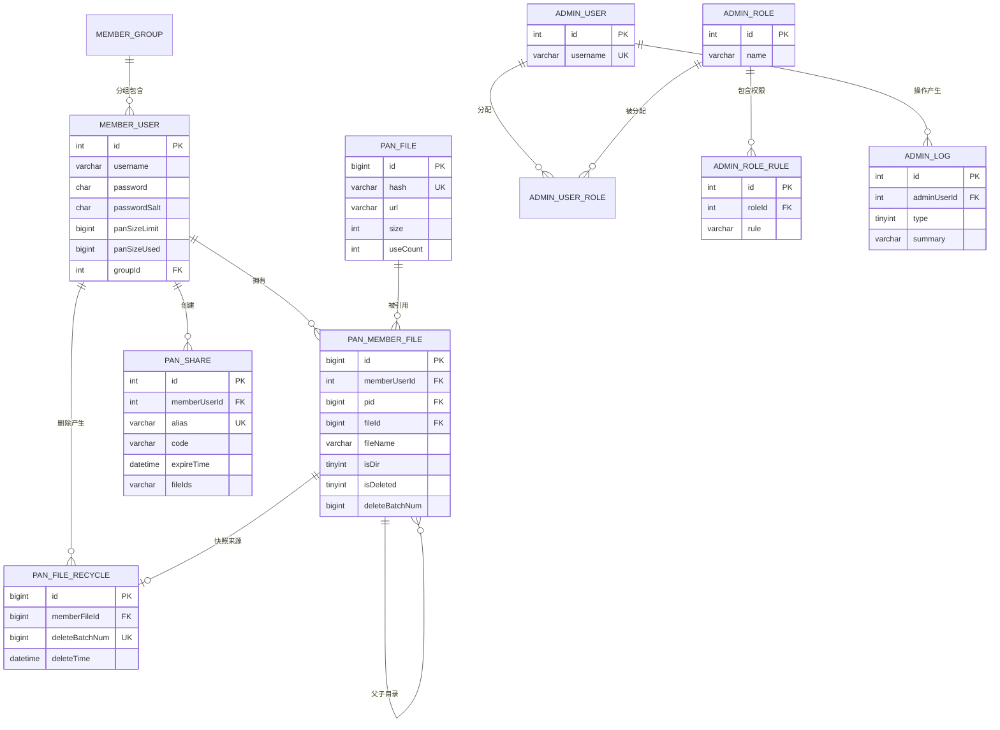

# 第 3 章 数据库设计

> 项目：个人云盘系统（若萱云盘）
> 数据库：MySQL 5.6　库名 `cs`　字符集 `utf8 / utf8_unicode_ci`　表前缀 `dome`
> 表数量：37 张（本章聚焦与业务强相关的 9 张核心表）

---

## 3.1 数据库选型与总体设计

### 3.1.1 选型理由

| 维度 | 说明 |
|---|---|
| 关系模型 | 用户、文件、目录、分享、回收站之间是典型的一对多/多对一关系，关系型数据库表达最自然 |
| 事务与一致性 | 上传、删除、分享等操作涉及多表写入，需要事务保证一致性 |
| 索引能力 | 文件列表按「用户 + 父目录」检索，分享按别名检索，都依赖 B+Tree 索引 |
| 运维成本 | MySQL 5.6 部署简单、社区资料充足，适合课程项目规模 |

### 3.1.2 设计原则

1. **逻辑分层**：用户层（`member_*`）、业务层（`pan_*`）、管理后台层（`admin_*`）、配置层（`config`）四类前缀隔离，便于权限和迁移管理。
2. **物理文件与逻辑文件分离**：`pan_file` 存「磁盘上真实存在的那一份文件」，`pan_member_file` 存「某个用户在某个目录下看到的那一条记录」。同一份文件被多人/多次上传时只占一份存储，靠 `hash` 去重。
3. **软删除**：删除不是 `DELETE`，而是把目录项移入回收站（`pan_file_recycle`）并打 `isDeleted` 标记，可还原。
4. **统一审计字段**：所有表都有 `created_at`、`updated_at`，后台操作额外记 `admin_log`。
5. **命名规范**：表名小写下划线；外键逻辑字段统一 `xxxId`；布尔字段 `isXxx`；时间字段以 `Time` 结尾。

---

## 3.2 概念结构设计（E-R 模型）

### 3.2.1 实体与属性

| 实体 | 主要属性 |
|---|---|
| 用户 | 用户 ID、用户名、手机、邮箱、密码、密码盐、昵称、状态、所属分组、网盘容量上限、已用容量 |
| 用户分组 | 分组 ID、名称、描述、是否默认 |
| 物理文件 | 文件 ID、存储路径、大小、内容哈希、引用计数 |
| 用户文件（目录项） | 记录 ID、所属用户、父目录 ID、指向的物理文件 ID、文件名、扩展名、类型、大小、是否目录、上传时间、是否删除 |
| 分享 | 分享 ID、所属用户、别名、分享时间、过期时间、名称、提取码、类型、状态、文件 ID 集合 |
| 回收站记录 | 记录 ID、所属用户、目录项快照、原目录项 ID、删除时间、删除批次号 |
| 管理员 | 管理员 ID、用户名、密码、密码盐、最后登录时间/IP |
| 角色 | 角色 ID、角色名 |
| 权限规则 | 规则 ID、所属角色、规则标识 |
| 操作日志 | 日志 ID、管理员 ID、类型、摘要 |

### 3.2.2 联系

- 用户 **1 : N** 用户文件（一个用户拥有多条目录项记录）
- 用户文件 **N : 1** 物理文件（多个用户/多次上传可指向同一物理文件，实现秒传与去重）
- 用户文件 **自关联 1 : N**（`pid` 指向同表的 `id`，构成目录树）
- 用户 **1 : N** 分享
- 用户 **1 : N** 回收站记录；回收站记录 **N : 1** 用户文件（`memberFileId`）
- 用户分组 **1 : N** 用户
- 管理员 **N : M** 角色（通过 `admin_user_role` 关联）
- 角色 **1 : N** 权限规则
- 管理员 **1 : N** 操作日志

### 3.2.3 E-R 图（Mermaid，可直接渲染进报告）



---

## 3.3 逻辑结构设计（核心表结构）

> 以下字段、类型、索引均取自实际库表结构（`SHOW CREATE TABLE` 实测）。

### 3.3.1 用户表 `domemember_user`

| 字段 | 类型 | 允许空 | 键 | 说明 |
|---|---|---|---|---|
| id | int(10) unsigned | 否 | PK | 用户 ID，自增 |
| username | varchar(50) | 是 | 索引 | 登录名 |
| phone | varchar(20) | 是 | 索引 | 手机号 |
| email | varchar(200) | 是 | 索引 | 邮箱 |
| password | char(32) | 是 | — | 密码（MD5(密码+盐)） |
| passwordSalt | char(16) | 是 | — | 随机密码盐，防彩虹表 |
| nickname | varchar(50) | 是 | 索引 | 昵称 |
| avatar / avatarMedium / avatarBig | varchar(100) | 是 | — | 三档头像地址 |
| status | tinyint(4) | 是 | — | 状态：1 正常 / 禁用 |
| groupId | int(11) | 是 | 逻辑 FK | 所属用户分组 |
| panSizeLimit | bigint(20) | 是 | — | 网盘容量上限（字节），默认 1GB |
| panSizeUsed | bigint(20) | 是 | — | 已用容量（字节），冗余统计字段 |
| lastLoginTime / lastLoginIp | timestamp / varchar(20) | 是 | — | 最后登录信息 |
| isDeleted / deleteAtTime | tinyint(4) / bigint(20) | 是 | 索引 | 注销标记与时间 |
| created_at / updated_at | timestamp | 否 | — | 审计字段 |

**设计说明**：`panSizeUsed` 是**冗余字段**，每次上传/删除同步加减，避免每次都去 `SUM(pan_member_file.size)` 全表扫描；代价是需要保证写入一致性（上传走事务，或失败时补偿）。

### 3.3.2 物理文件表 `domepan_file`

| 字段 | 类型 | 允许空 | 键 | 说明 |
|---|---|---|---|---|
| id | bigint(20) unsigned | 否 | PK | 物理文件 ID |
| url | varchar(200) | 是 | — | 相对存储路径，如 `data/disk/2026/10/21/xxx.txt` |
| size | int(11) | 是 | — | 字节大小 |
| hash | varchar(32) | 是 | **唯一索引** | 文件内容哈希（MD5），去重依据 |
| useCount | int(11) | 是 | — | 引用计数，为 0 时可清理物理文件 |

**设计说明**：`hash` 上的唯一索引是整个去重（秒传）机制的地基——上传前先按 `hash` 查，命中则直接新增一条 `pan_member_file` 记录，不落盘。

### 3.3.3 用户文件表 `domepan_member_file`（业务核心）

| 字段 | 类型 | 允许空 | 键 | 说明 |
|---|---|---|---|---|
| id | bigint(20) unsigned | 否 | PK | 目录项 ID |
| memberUserId | int(11) | 是 | 索引（联合唯一首列） | 所属用户 |
| pid | bigint(20) | 是 | — | 父目录的目录项 ID，根目录为 0 |
| fileId | bigint(20) | 是 | 逻辑 FK | 指向 `pan_file.id`；目录为空 |
| fileName | varchar(200) | 是 | 联合唯一 | 展示名 |
| ext | varchar(20) | 是 | — | 扩展名，供预览类型判断 |
| type | varchar(10) | 是 | — | 业务类型：image / video / audio / doc / other |
| size | int(11) | 是 | — | 大小 |
| isDir | tinyint(4) | 是 | — | 是否文件夹 |
| uploadTime | datetime | 是 | — | 上传时间 |
| isDeleted | tinyint(4) | 是 | — | 软删除标记 |
| deleteBatchNum | bigint(20) | 是 | 索引 | 删除批次号，一次批量删除共享一个批次 |
| created_at / updated_at | timestamp | 否 | — | 审计字段 |

**关键约束**：`UNIQUE (memberUserId, pid, fileName)` —— 保证**同一用户、同一目录下不允许重名**，把「目录内唯一性」下沉到数据库层而不是靠应用判断，避免并发下的竞态插入。

**索引选择理由**：文件列表的查询形态固定为「某用户 + 某父目录 + 分页」，因此联合唯一索引同时充当查询索引（最左前缀 `memberUserId` 命中）；`deleteBatchNum` 索引用于回收站按批次还原。

### 3.3.4 分享表 `domepan_share`

| 字段 | 类型 | 允许空 | 键 | 说明 |
|---|---|---|---|---|
| id | int(10) unsigned | 否 | PK | 分享 ID |
| memberUserId | int(11) | 是 | 索引 | 分享人 |
| alias | varchar(20) | 是 | **唯一索引** | 短链标识，分享链接 `/pan/s/{alias}` |
| shareTime / expireTime | datetime | 是 | — | 创建时间 / 过期时间 |
| name | varchar(100) | 是 | — | 分享名称 |
| code | varchar(10) | 是 | — | 提取码（4 位） |
| type | int(11) | 是 | — | 分享类型 |
| status | int(11) | 是 | — | 1 生效 / 0 失效 |
| fileIds | varchar(1000) | 是 | — | 被分享的目录项 ID 集合（JSON 字符串） |

**设计说明**：`alias` 唯一索引让短链查询变成一次等值命中；`fileIds` 用 JSON 字符串而不是关联表，是在「一次分享通常只含少量文件」前提下的反范式取舍，代价是无法直接用 SQL 关联查询分享内容。

### 3.3.5 回收站表 `domepan_file_recycle`

| 字段 | 类型 | 键 | 说明 |
|---|---|---|---|
| id | bigint(20) unsigned | PK | 回收站记录 ID |
| memberUserId | int(11) | 索引 | 所属用户 |
| entry | varchar(1000) | — | 删除时的目录项快照（JSON），保证原记录被改也能还原 |
| memberFileId | bigint(20) | 逻辑 FK | 原 `pan_member_file.id` |
| deleteTime | datetime | — | 删除时间 |
| deleteBatchNum | bigint(20) | **唯一索引** | 删除批次号，唯一约束保证批次幂等 |

### 3.3.6 用户分组表 `domemember_group`

| 字段 | 类型 | 说明 |
|---|---|---|
| id | int(10) unsigned PK | 分组 ID |
| title | varchar(50) | 分组名称 |
| description | varchar(200) | 描述 |
| isDefault | tinyint(4) | 是否注册默认分组 |
| showFront | tinyint(4) | 是否前台展示 |

### 3.3.7 管理员表 `domeadmin_user`

| 字段 | 类型 | 键 | 说明 |
|---|---|---|---|
| id | int(10) unsigned | PK | 管理员 ID |
| username | varchar(100) | **唯一** | 登录名 |
| password / passwordSalt | char(32) / char(16) | — | 加盐密码 |
| phone | varchar(11) | **唯一** | 手机 |
| email | varchar(100) | **唯一** | 邮箱 |
| lastLoginTime / lastLoginIp / lastChangePwdTime | — | — | 安全审计 |

### 3.3.8 角色与权限 `domeadmin_role` / `domeadmin_role_rule` / `domeadmin_user_role`

- `domeadmin_role`：`id`、`name`
- `domeadmin_role_rule`：`roleId`（索引）、`rule`（权限标识，如 `Pan:Admin:File:List`）
- `domeadmin_user_role`：`adminUserId`、`roleId` 的中间表，实现管理员与角色的多对多

**设计说明**：RBAC 三段式（用户—角色—权限），权限粒度到「菜单/按钮」，鉴权时按 `adminUserId` 查出角色集合再并集规则。

### 3.3.9 操作日志表 `domeadmin_log`

| 字段 | 类型 | 说明 |
|---|---|---|
| id | int(10) unsigned PK | 日志 ID |
| adminUserId | int(11) | 操作人 |
| type | tinyint(4) | 操作类型 |
| summary | varchar(400) | 操作摘要 |

关联表 `domeadmin_log_data` 保存变更前后的字段快照，用于审计追溯。

---

## 3.4 索引与约束汇总

| 表 | 索引/约束 | 类型 | 作用 |
|---|---|---|---|
| member_user | `member_user_username_index` | 普通 | 登录名检索 |
| member_user | phone / email / nickname / deleteAtTime 索引 | 普通 | 找回密码、后台筛选 |
| pan_file | `pan_file_hash_unique(hash)` | 唯一 | 去重/秒传 |
| pan_member_file | `pan_member_file_memberuserid_pid_filename_unique(memberUserId,pid,fileName)` | 唯一 | 目录内禁止重名 + 支撑列表查询 |
| pan_member_file | `pan_member_file_deletebatchnum_index` | 普通 | 回收站批次还原 |
| pan_share | `pan_share_alias_unique(alias)` | 唯一 | 短链等值查询 |
| pan_file_recycle | `pan_file_recycle_deletebatchnum_unique` | 唯一 | 批次幂等 |
| admin_user | username / phone / email 唯一 | 唯一 | 账号唯一性 |

**为什么用唯一索引而不是应用层判重**：并发上传同名文件时，两次请求的「先查后插」会同时通过检查；数据库唯一索引是唯一能在存储层兜住的地方，冲突时返回 1062 错误由应用转成「名称已存在」提示。

---

## 3.5 典型 SQL 场景

**① 目录列表分页**（走联合索引，覆盖 `memberUserId + pid`）

```sql
SELECT id, fileName, ext, type, size, isDir, uploadTime
FROM domepan_member_file
WHERE memberUserId = ? AND pid = ? AND isDeleted = 0
ORDER BY isDir DESC, uploadTime DESC
LIMIT 20 OFFSET 0;
```

**② 秒传判断**（唯一索引等值命中）

```sql
SELECT id, url, size FROM domepan_file WHERE hash = ?;
```

**③ 回收站还原**（按批次一次性还原）

```sql
UPDATE domepan_member_file SET isDeleted = 0, deleteBatchNum = NULL
WHERE deleteBatchNum = ? AND memberUserId = ?;
```

**④ 容量统计校验**（与冗余字段对账）

```sql
SELECT SUM(size) FROM domepan_member_file
WHERE memberUserId = ? AND isDeleted = 0 AND isDir = 0;
```

---

## 3.6 性能与优化说明

1. **分页深翻页问题**：`LIMIT 20 OFFSET 10000` 会先扫过前 1 万行。改造方向是记录上一页最后一条的 `(uploadTime, id)` 做游标分页（keyset pagination）。
2. **大目录计数**：`COUNT(*)` 在超大目录下成本高，可维护计数字段或用近似统计。
3. **存储引擎改造建议（本项目最大改进点）**：当前表为 MyISAM，**不支持事务与行锁**，上传过程中「写物理文件 + 写 pan_file + 写 pan_member_file」三步若中途失败会留下孤儿数据。生产环境应改为 InnoDB，并把三步放进同一事务；同时补上真实外键或在应用层做级联校验。
4. **失效分享清理**：`expireTime` 上没有索引，建议加 `(status, expireTime)` 联合索引，配合定时任务批量置为失效。
5. **慢查询观测**：开启 `slow_query_log`（阈值 1s），配合 `EXPLAIN` 验证上述 SQL 是否命中索引，报告中附 `EXPLAIN` 结果截图。

---

## 3.7 本章小结

本系统数据库以「**物理文件与逻辑文件分离 + 哈希去重 + 软删除回收站**」为主线，用 5 张表撑起网盘的核心业务（用户、物理文件、目录项、分享、回收站），再用 RBAC 三表与日志表支撑后台权限与审计。约束设计上把「目录内不重名」「分享别名唯一」「去重哈希唯一」三条业务规则下沉到数据库唯一索引，既保证了并发正确性，也顺带提供了查询索引。
